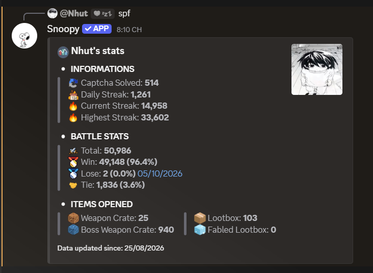

# 🐾 Snoopy 🐾

### Reminder • Stats • Leaderboard • Freestyle

Release Date: 21/08/2026 (Private Only)

---

## 🚀 Features

- Reminders: Hunt/Battle, Pray/Curse, Huntbot, and Captcha.
- Captcha alerts with optional phone notifications.
- Profile statistics for activity and battle results, items counter.
- Server leaderboards.
- Interactive settings with buttons and menus (i put lots of care into Snoopy's UI).
- Combined with AutoHotkey.

## 📊 Profile Statistics Preview

## 📖 About This Repository

i dont even know when i will make the bot public :D

